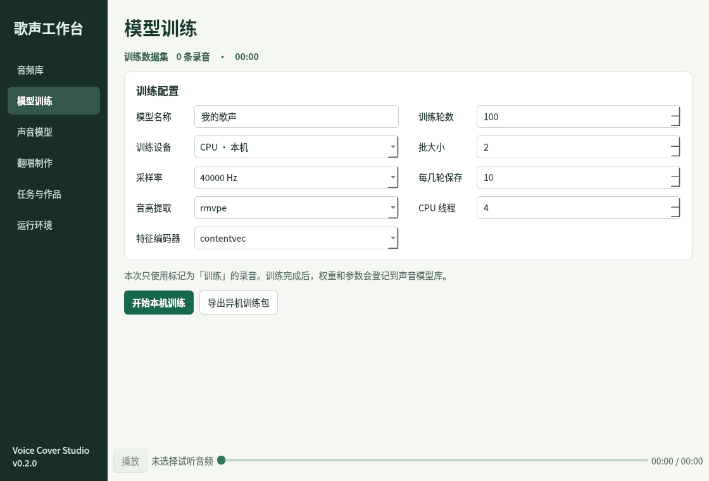

# 歌声工作台 · Voice Cover Studio 0.2.3

用自己的录音训练 RVC 模型，把指定歌曲换成自己的声音。Windows 桌面应用采用 PyQt5，音频、模型元数据、训练参数和任务历史保存在本机。模型训练与转换调用 Applio 3.7.2，整曲分轨调用 Demucs，混音调用 FFmpeg。

## 启动

Windows 10/11 x64 可使用 Python 3.12 x64（含 3.12.10）或 Python 3.11 x64。完整解压后双击根目录的 **VoiceCoverStudio.exe**。这是 Windows x64 图形启动器，使用本机的 Python，首次准备桌面环境会显示进度窗口。桌面启动器与分轨安装脚本优先复用各自已有的虚拟环境；首次创建时依次查找 `py -3.12`、`py -3.11` 和 PATH 上的 `python`。首次启动会联网安装桌面依赖。可以马上录音、导入单声道 PCM16 WAV、看波形和管理样本。上一版的 WAV 可直接在「音频库 → 导入音频」中批量选入，评估样本另设为「评估」。

训练和翻唱引擎按需安装一次：

1. **训练与换声**：进入「运行环境 → 下载 Applio 3.7.2 Windows 包」，完整解压官方预编译包。在「Applio 3.7.2 目录」选择直接包含 `core.py` 的文件夹，点击「保存配置」。预编译包自带 Python，引擎解释器可留空。在「检查环境」看到 Applio 可用后，点击「下载引擎基础资源」。[官方发行说明](https://github.com/IAHispano/Applio/releases/tag/3.7.2)
2. **压缩音频、试听和翻唱**：在「运行环境」点击「安装 FFmpeg」，任务会检查 `ffmpeg.exe`、`ffprobe.exe`，需要时通过 WinGet 安装。如果从[发行方](https://www.gyan.dev/ffmpeg/builds/)手动安装，请将解压后的 `bin` 加入 PATH，重启工作台。使用带伴奏的歌曲可直接点「安装 CPU 分轨」，它会同时准备 FFmpeg 和项目下的 `.splitter`，首次分轨下载 htdemucs。Demucs 解释器留空即可使用该环境，已有外部环境可选其 `python.exe`。双击 `setup-splitter.cmd` 也可安装。安装日志在「任务与作品」查看。
3. **无 NVIDIA 独显**：选择「CPU · 本机」即可提交本地训练；预处理、特征提取、训练和推理都有独立阶段或日志。建议先用一小批干声、少量轮数验证安装并测量每轮耗时，再决定是否完成全量训练。若太慢，点「导出异机训练包」，在已装同版 Applio 的另一台机器运行包内 `train.py`，将生成的 `.vmodel` 导回。异机训练包需要自行传递，工作台不会上传个人录音。当前整曲分轨固定走 CPU。

## 工作区

| 页面 | 可执行的操作 |
| --- | --- |
| 音频库 | 选择麦克风，录制 PCM WAV，批量导入 WAV/FLAC/MP3/M4A 等；试听、看波形/时长/峰值，搜索、重命名、多选调整训练/评估/归档用途。相同文件按 SHA-256 去重。 |
| 模型训练 | 调整名称、CPU/CUDA、采样率、训练轮数、批大小、保存间隔、线程、音高提取算法和特征编码器。本次采用提交时的训练样本清单，每次训练使用独立实验号。 |
| 声音模型 | 训练结果自动入库，支持导入已有推理权重和对应索引、重命名、查看训练参数、导出或导入模型包。相同显示名称可以保留多个训练版本。 |
| 翻唱制作 | 选择原曲和已登记的模型，生成指定秒数的试听或完整歌曲。可调移调、索引强度、清辅音保护、音量包络、人声增益和音高算法。训练时的特征编码器自动沿用。 |
| 任务与作品 | 查看运行阶段、日志和失败原因，停止进行中的任务，分别播放对齐的参考片段和生成片段，打开作品目录。 |
| 运行环境 | 选择独立引擎及其解释器、保存配置、检查 FFmpeg/PyTorch/CUDA/Demucs，下载 Applio 的基础资源。 |

**第一个听感对照**：挑一首主唱清楚的独唱，先选你自然音域内的 20 秒，移调保持 0。音色相似度可以和你没放入训练集的录音对照；字头、节奏和滑音大多跟随参考演唱。若主要问题出在和声或伴奏串音，先听输出目录的分离人声，再决定要不要重新训练。调高/降低人声半音会改变它与伴奏的音程关系。

## 数据与工程

默认工作目录为 `%LOCALAPPDATA%/VoiceCoverStudio`，也可通过 `VOICE_STUDIO_HOME` 指定。原始音频与训练用 PCM、模型文件、数据库、任务日志、分轨及翻唱输出均在其中。上游另在自己的实验目录保留训练检查点；保留该目录可用于在 Applio 中续训。异机训练包只含本次训练音频、参数和标准库启动程序。声音模型包内有权重、可选索引和模型元数据。请只加载自己训练或来源可信的权重。

| 源码 | 职责 |
| --- | --- |
| `voice_studio/app.py`、`pages.py`、`widgets.py` | 原生桌面窗口、录音与播放、工作区交互 |
| `voice_studio/store.py` | SQLite、音频质检、权重和索引管理 |
| `voice_studio/jobs.py`、`worker.py` | 后台子进程、取消、阶段日志、异常退出恢复 |
| `voice_studio/engine.py`、`portable.py` | Applio/Demucs/FFmpeg 适配、跨机器训练 |
| `tests/` | 样本去重、训练集隔离、模型包往返和音轨时长回归 |

启动异常时，提示框会给出启动日志路径，默认位于 `%LOCALAPPDATA%/VoiceCoverStudio/logs/startup.log`。启动器的 C 源码在 `launcher/`。需要自行重编时，在 Windows 上使用 Visual Studio C++ 工具执行 `cmake -S launcher -B build/launcher -A x64` 和 `cmake --build build/launcher --config Release`，把 Release 产物复制到项目根目录。

开发启动 `python -m pip install -e .` 后执行 `python -m voice_studio`，局部测试执行 `python -m unittest discover -s tests -v`。根目录 `voice_cover.py` 保留命令行训练、换声和混音入口。Windows 录音、播放依赖系统允许应用访问相应音频设备。

## 查过的上游工程

| 项目 | 已核实的能力 | 在本项目中的用途 |
| --- | --- | --- |
| [UtaiSynthesizer](https://github.com/yasoukyoku/UtaiSynthesizer) · [中文手册](https://github.com/yasoukyoku/UtaiSynthesizer/blob/main/docs/user-guide.zh-CN.md) · [Windows 发行版](https://github.com/yasoukyoku/UtaiSynthesizer/releases) | 项目式管理干声、后台 RVC/SoVITS 训练、通用 CPU 训练包、试听训练结果、时间线分轨换声和导出。 | 完整现成工作站，也是训练后直接选模型制作歌曲的交互参照。 |
| [Applio](https://github.com/IAHispano/Applio/tree/3.7.2) · [CLI](https://docs.applio.org/reference/cli/) · [Hugging Face 资源](https://huggingface.co/IAHispano/Applio/tree/main/Resources) | 预处理、音高和内容特征提取、训练、导出权重、检索索引和换声。官方托管 ContentVec 和 RMVPE。 | **实际调用的训练及换声引擎**。CPU 模式对提取和训练显式传入设备标记 `-`。 |
| [Ultimate RVC](https://github.com/JackismyShephard/ultimate-rvc) | 从指定歌曲一键制作翻唱，可管理声音模型和音频。官方本地安装方案侧重 NVIDIA。 | 一键完成整曲转换的交互参照。 |
| [Demucs](https://github.com/facebookresearch/demucs) | 在 CPU 上分离人声与伴奏。 | **实际调用的整曲分轨引擎**。 |

已验证桌面页面切换、真实 WAV 入库、模型包往返和 FFmpeg 两轨混音；训练/推理命令与 3.7.2 参数解析和任务编排用替代计算阶段验证。没有随包附带个人模型。Windows 真机麦克风、实际模型计算和最终音质需要在目标机器上验证。
